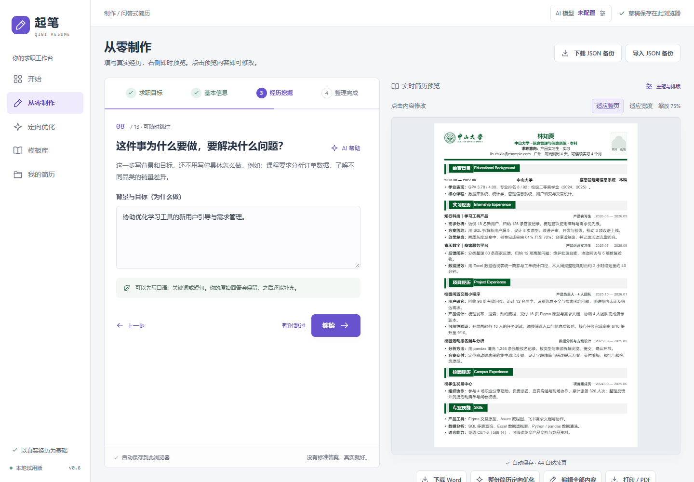
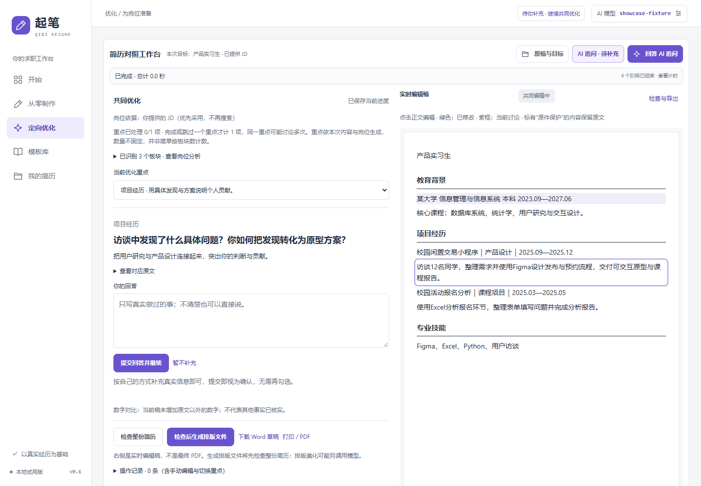
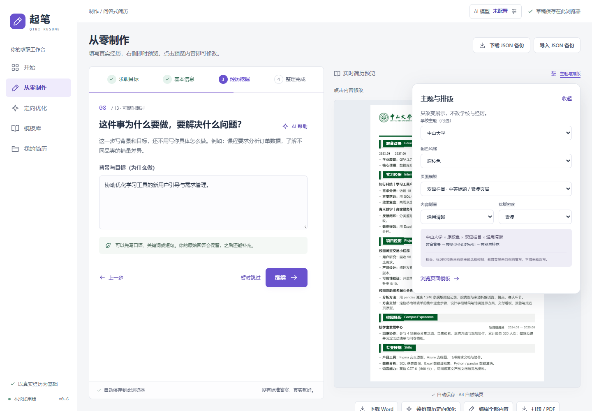

# 起笔 Qibi · AI 简历工作台

### 你做过的事，值得被讲清楚。

一个面向中国学生的简历工作台：从零梳理经历，也能带着已有简历与目标岗位，和 AI 一起打磨出适合投递的版本。

起笔把重点放在一个常被忽略的问题上：**学生往往不是没有经历，而是不知道哪些经历值得写、如何说明自己的贡献。**

所以，我们没有把简历优化做成一次提交、等待一份陌生成稿。我们希望 AI 先读懂经历，再结合岗位要求逐项讨论；有疑问就问清楚，有改动就在工作台里看得见，让用户始终参与自己的表达。

**[浏览交互演示](https://xuehb5.github.io/qibi-resume-studio-showcase/) · [查看界面实录](#界面实录) · [了解设计思路](docs/product.md)**

> 这是公开展示仓库，包含项目介绍、虚构样例、工作台截图和静态交互演示。核心应用源码保持私有。演示不接收真实简历、不调用模型；在线地址须在 GitHub Pages 部署成功后方可访问。



## 从“不知道写什么”，到一份可以继续修改的简历

第一次找实习，课程作业、校园活动、科研课题是否能写进简历？已经写好一份简历，换一个岗位又应该突出什么？

起笔围绕这两种真实需求提供两个入口：

| 你的起点 | 起笔如何协助 |
| --- | --- |
| **从零开始** | 用逐步问答整理求职目标、多阶段教育背景、项目与实践经历；每一步都可以获得 AI 建议，右侧同步呈现简历。 |
| **已有简历** | 导入 PDF / Word，结合岗位 JD 理解栏目与内容，逐项讨论需要补充或改进的地方，再输出独立修改稿。 |

没有实习也能开始。课程设计、实验研究、社团工作、竞赛和个人作品，都可以成为讲清能力的材料；岗位目标支持自由填写。

## 让每一次修改都有来由

### 先理解，再提问，最后改写

简历优化需要理解原文中“做了什么、本人负责什么、结果是什么”。起笔先识别内容结构与岗位重点，再围绕薄弱之处逐项追问，一次讨论一个问题。用户提交回答即可继续，补充的信息会进入后续改写。

例如，“参与数据分析”需要先问清数据对象、处理方法和个人产出，才能写成有信息量的经历。系统通过提示词与结构校验约束改写；不能把岗位要求直接变成候选人的能力，也不应为好看凭空补数字。

### 修改就在简历里，看得见，也改得动

工作台提供原稿与修改稿对照、可编辑内容预览和文件预览。点击预览中的内容或栏目标题，可以定位相应编辑区。用户可以修改、撤回或继续讨论；原件与独立修改稿分别保留。

### 学校特色与版式自由组合

学校主题、配色、页面模板、内容侧重与密度分别选择。**填写哪所学校，不会替用户决定用什么主题；切换外观，也不会改掉履历。**

当前本地版本提供 148 所学校主题、7 种页面版式和 6 类内容侧重，覆盖科研、技术、商业等不同叙事需求，并可选择无学校主题。学校标识来源、适配状态和部分待补素材有独立记录；这些并非高校官方简历模板。

### 成稿仍然属于用户

支持可编辑 Word 下载、打印 / PDF、JSON 备份与多个投递版本。用户可选择尝试保留原主题调整文件，或迁移到网站模板；复杂 PDF、扫描件与特殊 Word 排版有明确处理边界，不承诺任意文件无损转换。

## 界面实录

以下截图来自实际应用的隔离演示会话，人物和经历均为虚构。截图展示交互，不作为模型改写质量的承诺。

| 从零制作：边梳理，边成稿 | 逐项协作：把问题放回具体经历 |
| --- | --- |
|  |  |



## 一条完整的协作路径

```text
原始简历 / 从零提供经历
          ↓
理解内容结构与个人贡献
          ↓
结合岗位 JD 确定讨论重点
          ↓
逐项提问 → 用户补充 → 更新工作台草稿
          ↓
整份复核 → 选择排版 → 预览并导出
```

从零制作也有逐步 AI 辅导。上图主要说明已有简历的协作优化流程；没有 JD 时可依据岗位名称提供一般性建议，不把推测当作该公司真实要求。

## 我们关注的工程细节

- **内容、主题与文件分层处理**：岗位表达优化与外观选择分开，减少换模板时丢失信息的风险。
- **长任务有状态**：显示分阶段计时，切换页面后可查询同一任务；失败保留已有结果，避免盲目自动重试带来重复费用。服务器重启仍可能中断任务，不承诺后台永久续跑。
- **考虑文档实际效果**：浏览器预览与原生 Word 的分页可能不同；文档验证包含内容复读、图片与样式保留、实际导出检查。
- **控制传输与重复处理**：上传文件以服务端文件标识复用，后续步骤尽量传递任务引用；当前单文件上限 20 MiB，原简历正文上限 10,000 字。
- **不要求注册才能整理经历**：草稿与多个版本存于当前浏览器，不做账号云同步；调用模型时相关正文和 JD 会发送到用户选择的供应商。

应用原型使用 JavaScript / Node.js、Python 文档处理与 LibreOffice 转换，接入兼容 Chat Completions 的模型接口；当前本地配置使用 Windows 加密存储。这些是实际实现方向，不代表已经完成公网商用验收。

## 体验这个展示仓库

仓库根目录是无需构建的静态页面。直接打开 `index.html`，或在安装 Python 后执行：

```bash
python -m http.server 8080
```

访问 `http://localhost:8080`。交互演示使用预设的虚构案例，可切换案例、逐步查看追问与改写，并对照工作台截图；不包含核心服务，不提供真实 AI 调用或文档上传。

GitHub Pages 使用本仓库的部署工作流发布静态展示页。它不会发布核心应用、API Key、用户简历或文档处理引擎。

## 项目状态与素材说明

项目处于本地可运行、持续迭代阶段。已有多专业样例、浏览器交互及导出回归实践；模型质量随原始材料、岗位信息和所选模型变化，仍需要真实场景检验。

本仓库仅用于展示项目，不授予核心产品源码许可。学校名称及标识不表示合作、授权或背书；正式商业使用须另行核对素材条件。公开样例均为虚构，未包含用户原始简历、模型凭据或内部运行数据。

**起笔的目标很具体：让一个学生把真实经历讲清楚，也让每一次修改都掌握在自己手里。**
